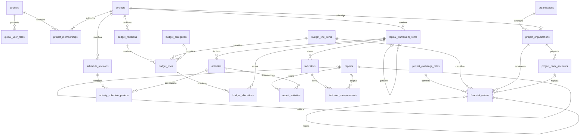

# Modello dati — Milestone 2

Data: 7 ottobre 2026. Versione 2: indicazioni dell’utente recepite.
**Stato: modello approvato, Milestone 2 conclusa; consegna versionata su `main`.
Migration fondative introdotte dalla [Milestone 3](milestone-3.md),
verificate in isolamento e applicate al backend dedicato il 7 ottobre 2026.**

Questa specifica dettaglia le sezioni 4–6 della [roadmap](roadmap-gestione-progetti.md).
Le scelte sotto recepiscono le indicazioni riportate dall’utente nella consegna.
I dettagli tecnici traducono tali indicazioni in un contratto per le future migration.
La [matrice dei permessi](permissions.md) è parte integrante del modello.
La [consegna](milestone-2.md) riporta verifiche e criterio di chiusura.

## 1. Scelte concordate e confini

| Tema | Proposta per la prima versione | Alternativa e conseguenza |
| --- | --- | --- |
| Organizzazioni | Una piattaforma, progetti condotti da enti diversi: un ente singolo oppure capofila e partner | Gli enti non sono tenant: l’accesso dipende dalle assegnazioni ai progetti |
| Quadro logico | Modello ibrido con un solo padre; attività separate collegate a un risultato | Relazioni molti-a-molti e sotto-attività rinviate |
| Indicatori | Assoluto o rapporto; rilevazioni canoniche uniche | Dati registrati da Manager/Admin immediatamente validati |
| Revisioni | Snapshot completi e immutabili di budget e cronogramma pubblicati | Manager assegnato e Admin possono pubblicare, senza secondo approvatore |
| Valute | Valuta principale del finanziamento; primo progetto in EUR; spese anche in altre valute | Conversione con tasso medio mensile; frequenza giornaliera e acquisizione automatica futura |
| Ruoli MVP | Solo Admin globale e Manager assegnato | Operator e viewer esclusi da schema, policy e UI MVP; requisiti da definire in seguito |
| Storico | Audit e revisioni; archiviazione, rettifiche dei dati registrati | Nessuna sovrascrittura distruttiva dello storico |

Lingua UI, allegati, notifiche e task restano alle milestone funzionali.
Le regole tecniche sui cambi sono descritte nella sezione 7: aggiornare il mese
corrente non deve alterare silenziosamente spese già registrate.

## 2. Convenzioni del dizionario

- Nomi SQL inglesi in `snake_case`; PK `id uuid` salvo eccezioni esplicite.
- `!` indica NOT NULL; `?` indica nullable; `→` indica una FK. I campi elencati
  includono la PK e il gruppo comune dove indicato.
- `A` = `created_at timestamptz!`, `created_by uuid? → profiles`,
  `updated_at timestamptz!`, `updated_by uuid? → profiles`, `row_version bigint!`.
  Timestamp e autori sono assegnati dal database; autore nullo solo per bootstrap
  o processi di sistema identificati nell'audit. `row_version` parte da 1 e aumenta
  a ogni modifica; le scritture confrontano la versione letta per evitare perdite.
- `P` = `id uuid! PK`, `project_id uuid! → projects`, `A`,
  vincolo `UNIQUE(project_id, id)`. Tutte le FK fra dati di progetto includono
  `project_id`: una FK sul solo UUID non prova l'appartenenza allo stesso progetto.
- Quantità e rapporti: `numeric(20,6)`; denaro: `numeric(20,6)` per importi originali, `numeric(18,2)` per EUR e importi della
  valuta principale nella prima versione; mai floating point. Valute principali
  con precisione diversa da due decimali richiedono un’estensione prima dell’uso.
  Rifiutare valori non finiti e importi/quantità negativi nei domini qui previsti.
- Date operative `date`; istanti di audit `timestamptz` in UTC. Intervalli di date
  inclusivi con fine ≥ inizio. Testi obbligatori non vuoti dopo trim.
- Stati/tipi/ruoli: inizialmente `text` con CHECK su valori chiusi qui elencati;
  nessuna tabella `roles` editabile e nessun enum PostgreSQL necessario nella v1.
- FK con RESTRICT per la cancellazione; utenti disabilitati, non rimossi. La
  cancellazione degli account Auth richiede una procedura successiva di conservazione
  dello storico. Nessuna cascata che cancelli budget, rapporti o audit.
- Progetti archiviati sono in sola lettura (Admin o Manager assegnato può riaprirli con audit).
  Le entità archiviate mantengono riferimenti e storico; niente nuovi riferimenti
  a entità archiviate, salvo la copia di snapshot storici. La composizione degli enti può essere aggiornata
  dal Manager tramite operazione transazionale; rimozioni di associazioni preservate
  nell’audit e subordinate ai vincoli del partenariato.
- Le regole che coinvolgono altre righe o tabelle richiedono FK composte, trigger
  o operazioni transazionali nel DB: non basta validarle nel form o con RLS.

## 3. Relazioni principali

Il diagramma riassume le relazioni; il dizionario sotto specifica tutte le tabelle.

## 4. Identità, progetti e accessi

| Tabella | Campi | Vincoli e significato |
| --- | --- | --- |
| `profiles` | `id uuid! PK → auth.users.id`, `display_name text!`, `is_active boolean!` (true), `A` | Profilo creato dal flusso Auth controllato; email e credenziali restano in Auth. L'utente modifica soltanto il proprio nome, mai lo stato |
| `global_user_roles` | `user_id uuid! PK → profiles`, `role text!` (`admin`), `A` | Zero o una riga per utente; assegnazione solo admin, bootstrap fuori dal client; vietato disabilitare/rimuovere l'ultimo admin attivo |
| `projects` | `id uuid! PK`, `code text!`, `title text!`, `description text?`, `status text!`, `start_date date!`, `end_date date!`, `donor text?`, `currency_code text!`, `notes text?`, `A` | Codice univoco normalizzato maiuscolo; stati `draft/active/completed/archived`; valuta di 3 lettere da elenco ammesso dall'applicazione; non cambiare valuta dopo il primo dato economico |
| `project_memberships` | `P`, `user_id uuid! → profiles`, `role text!` (`manager`), `status text!` | `UNIQUE(project_id,user_id)`; stati `active/inactive`; assegnazioni gestite da Admin |
| `organizations` | `id uuid! PK`, `code text!`, `name text!`, `country_code text?`, `status text!`, `A` | Codice univoco normalizzato; stati `active/archived`; anagrafica condivisa della piattaforma, gestita da Admin |
| `project_organizations` | `P`, `organization_id uuid! → organizations`, `role text!`, `notes text?` | `UNIQUE(project_id,organization_id)`; ruolo `sole/lead/partner`; Manager gestisce composizione dei propri progetti scegliendo enti esistenti |

Un progetto draft può avere composizione incompleta. Per attivarlo deve avere
esattamente un ente `sole`, senza altri enti, oppure esattamente un `lead` e
almeno un `partner`. Indice univoco parziale sul progetto per i ruoli sole/lead,
e controllo differito sotto lock del progetto per tutte le modifiche alla
composizione e allo stato. La stessa organizzazione può partecipare a più progetti
con ruoli diversi. Cambiare partenariato è tracciato nell’audit.

L’organizzazione non attribuisce accessi ai suoi utenti: solo Admin assegna Manager
ai progetti. Un Manager vede l’anagrafica degli enti collegati ai propri progetti;
la ricerca degli enti per aggiungerli restituisce solo id, codice e nome tramite
API controllata, senza rivelare altri progetti o partenariati. Un nuovo ente viene
creato da Admin, evitando che un Manager modifichi anagrafiche condivise.

Non memorizzare il ruolo globale in campi modificabili del profilo o in metadata
forniti dal client. Profilo disabilitato revoca ogni accesso; membership inattiva
revoca quello al progetto. Admin crea/invita gli utenti tramite Auth e assegna
le membership. Il Manager legge e scrive tutti i dati dei progetti assegnati,
compresi budget, rapporti e piani; non crea progetti, utenti o assegnazioni.
Non introdurre `activity_assignments`, ruoli operator/viewer o flag budget nell’MVP.

## 5. Quadro logico, attività e indicatori

| Tabella | Campi | Vincoli e significato |
| --- | --- | --- |
| `logical_framework_items` | `P`, `parent_id uuid? → logical_framework_items`, `type text!`, `code text!`, `title text!`, `description text?`, `assumptions text?`, `sort_order integer!`, `status text!` | `UNIQUE(project_id,code)`; tipi `general_objective/specific_objective/expected_result`; stati `active/archived`; ordine ≥ 0, pareggi ordinati per id |
| `activities` | `P`, `result_id uuid! → logical_framework_items`, `code text!`, `title text!`, `description text?`, `status text!`, `priority text!`, `sort_order integer!`, `notes text?` | `UNIQUE(project_id,code)`; risultato obbligatorio; stati `planned/in_progress/completed/cancelled/archived`; priorità `low/normal/high`; ordine ≥ 0 |
| `indicators` | `P`, `framework_item_id uuid! → logical_framework_items`, `code text!`, `title text!`, `description text?`, `verification_source text!`, `type text!`, `unit text!`, `aggregation_method text!`, `direction text!`, `ratio_scale numeric!`, `baseline_date date?`, `baseline_value numeric(20,6)?`, `baseline_numerator numeric(20,6)?`, `baseline_denominator numeric(20,6)?`, `target_date date?`, `target_value numeric(20,6)?`, `target_numerator numeric(20,6)?`, `target_denominator numeric(20,6)?`, `status text!` | `UNIQUE(project_id,code)`; tipi `absolute/ratio`; stati `draft/active/archived`; direzione `increase/decrease`; scala 1 o 100, scala 1 per absolute |
| `indicator_measurements` | `P`, `indicator_id uuid! → indicators`, `activity_id uuid? → activities`, `source_report_id uuid? → reports`, `period_start date!`, `period_end date!`, `value numeric(20,6)?`, `numerator numeric(20,6)?`, `denominator numeric(20,6)?`, `source_note text?`, `supersedes_measurement_id uuid? → indicator_measurements`, `status text!`, `validated_by uuid? → profiles`, `validated_at timestamptz?` | Stati `draft/validated`; una rilevazione per `(project_id,source_report_id,indicator_id,activity_id)` quando proviene da rapporto; rilevazioni manuali con fonte obbligatoria |

### Campi descrittivi della Milestone 9 — 20 ottobre 2026

La definizione `indicators` include anche `reference_code`, `measurement_period`,
`numerator_definition`, `denominator_definition`, `baseline_note`, `target_note`:
testi facoltativi fino a 10000 caratteri. Precisano codifica, popolazione/frequenza,
metodo e dati non disponibili senza sostituire i valori numerici o le date.
L’esempio Tirana fornito dall’utente ha guidato questi campi; nessun dato è importato.
Per anni o mesi relativi non ancora traducibili in date documentate usare le note
e mantenere la bozza. I vincoli di attivazione approvati restano invariati.
Una soglia ratio normalizzata (es. 80/100) va dichiarata come soglia nelle note,
senza rappresentarla come numerosità osservata. Tassi ufficiali già calcolati
possono usare `absolute` con unità esplicita e aggregazione `last`.

### Gerarchia e modifiche strutturali

Un obiettivo generale non ha padre. Uno specifico ha esattamente un generale;
un risultato ha esattamente uno specifico. Tutti nello stesso progetto.
Questi livelli escludono cicli; controllare anche gli UPDATE del padre e del tipo.
Attività riferite soltanto a risultati. Una volta referenziato, un elemento non
cambia tipo; reparenting nello stesso progetto ammesso solo se non invalida
rilevazioni/rapporti esistenti. `project_id` è immutabile per ogni entità.

L'indicatore misura un elemento del quadro logico. Se una rilevazione ha
`activity_id`, il suo indicatore deve riferirsi al risultato dell'attività o a
uno dei suoi antenati. Una modifica strutturale che renderebbe incoerente questa
relazione è respinta; si archivia e si crea una nuova definizione.

### Valori, baseline, target e aggregazioni

Per absolute è valorizzato solo `value`; per ratio solo numeratore e denominatore,
con denominatore > 0. La stessa esclusività vale per baseline e target.
In bozza sono ammessi gruppi baseline/target interamente nulli, mai parziali;
per attivare l'indicatore servono baseline, target e rispettive date, con
`target_date >= baseline_date`. Numeratore ≤ denominatore non è un vincolo
universale: alcuni rapporti possono superare 1. Percentuale = `100 × n/d`.

Metodi ammessi: absolute `sum/last/mean`; ratio `ratio_of_sums/last`.
Per ratio non si fa la media semplice delle percentuali. Somma dei numeratori
sulla somma dei denominatori: 20/100 e 30/50 danno 50/150 = 33,33%, non 40%.
`mean` è media aritmetica non ponderata e richiede osservazioni omogenee.
`last` sceglie la maggiore `period_end`; i pareggi usano `validated_at`, poi id,
con ordinamento esplicito. Non equivale a una somma cumulativa.

Per un intervallo richiesto si includono solo osservazioni completamente contenute
nell'intervallo; quelle a cavallo sono segnalate, mai ripartite proporzionalmente.
Per `last` si usa l'ultima osservazione conclusa entro la data di riferimento.
Baseline e target non si sommano alle rilevazioni. Senza valori validati il risultato
è nullo («nessun dato»), non zero. Per percentuale di raggiungimento rispetto
alla baseline usare `(corrente-baseline)/(target-baseline) × 100`; target uguale
alla baseline rende questa metrica non definita. Non troncare i valori oltre 100%.

`sum` e `ratio_of_sums` richiedono contributi additivi, non cumulativi: periodi
sovrapposti tra attività possono essere legittimi, ma il Manager/Admin che registra deve escludere
la doppia conta delle stesse persone/eventi. Il modello non contiene anagrafiche
beneficiari e non può deduplicarle automaticamente. Per serie cumulative usare
`last`. Type, unità, scala, aggregazione, baseline e target sono congelati dopo
la prima rilevazione validata; cambi metodologici richiedono un nuovo indicatore,
archiviando il precedente. Target temporali multipli restano fuori dalla v1.

### Un'unica fonte quantitativa

`indicator_measurements` è la sola tabella dei valori osservati.
`report_indicator_values` e `indicator_contributions` della roadmap non diventano
copie fisiche: potranno essere viste filtrate delle rilevazioni, con gli stessi
permessi. Per una rilevazione da rapporto sono obbligatori `activity_id` e il
collegamento composto `(project_id, source_report_id, activity_id)` a
`report_activities`. Periodo uguale al periodo del rapporto.
Stato e validatore sono allineati al rapporto nella stessa transazione, mai
modificabili separatamente. La registrazione da Manager/Admin valida automaticamente
i dati, anche propri; `validated_by` identifica chi registra.

Concorrono alle metriche soltanto rilevazioni validate, non sostituite da una
rettifica validata. Per le manuali escludere il predecessore solo quando la sua rettifica è validata.
Un indicatore archiviato conserva i suoi valori storici;
archiviare l'indicatore ne vieta nuove rilevazioni, non cancella i risultati.

### Anticipo attività e date — richiesta del 16 ottobre 2026

L’utente autorizza l’inserimento delle attività nel quadro logico prima delle
milestone 10–11. A `activities` si aggiungono `planned_start_date date!`,
`planned_end_date date!`, `actual_start_date date?`, `actual_end_date date?`.
Ogni attività appartiene a un risultato dello stesso progetto. Le date previste
sono obbligatorie; quelle effettive possono restare vuote. Ogni fine è uguale o
successiva al rispettivo inizio; la fine effettiva richiede l’inizio effettivo.
Le date effettive possono differire dal piano, anche oltre il periodo previsto.

Lo stato operativo è calcolato nel DB: senza date effettive `planned`, con solo
inizio `in_progress`, con entrambe `completed`. Archiviazione separata, senza
cancellazione; per riattivare deve essere attivo il risultato. Anche le attività
concluse vanno archiviate prima del risultato. Il tipo del risultato referenziato
non può cambiare, neppure se le sue attività sono archiviate. `cancelled` rimane
nel modello per evoluzioni successive, non esposto in questa interfaccia.

Questa prima implementazione usa un singolo intervallo previsto modificabile,
con date precedenti e successive conservate nell’audit. Non è una revisione
ufficiale di cronogramma. La milestone 11 dovrà migrare il piano corrente nei
periodi versionati descritti sotto, conservando i dati inseriti ed evitando due
fonti modificabili per le date previste. Periodi multipli, pubblicazione e Gantt
restano rinviati. I vincoli rispetto alle date del progetto saranno applicati
alla pubblicazione del cronogramma; qui si controlla la coerenza dei due intervalli.

## 6. Cronogramma e revisioni

| Tabella | Campi | Vincoli e significato |
| --- | --- | --- |
| `schedule_revisions` | `P`, `revision_number integer!`, `based_on_id uuid? → schedule_revisions`, `title text!`, `reason text!`, `status text!`, `approved_by uuid? → profiles`, `approved_at timestamptz?` | `UNIQUE(project_id,revision_number)`; numero ≥ 1; stati `draft/approved`; prima versione approvata = piano iniziale; base dello stesso progetto |
| `activity_schedule_periods` | `P`, `revision_id uuid! → schedule_revisions`, `activity_id uuid! → activities`, `period_key uuid!`, `start_date date!`, `end_date date!`, `title text!`, `status text!`, `notes text?` | `UNIQUE(project_id,revision_id,period_key)`; stati `planned/cancelled`; più periodi per attività; key stabile fra copie della revisione |
| `project_schedule_state` | `project_id uuid! PK → projects`, `initial_revision_id uuid! → schedule_revisions`, `current_revision_id uuid! → schedule_revisions`, `A` | Entrambe FK composte con progetto; puntano solo a revisioni approvate; riga assente prima della prima approvazione |

Snapshot completi: una nuova bozza copia i periodi del piano corrente preservando
`period_key`; un periodo nuovo riceve una nuova key. La key non cambia attività
fra revisioni. Per eliminare un periodo dalla pianificazione successiva lo si
mantiene con stato cancelled; lo snapshot iniziale resta consultabile.
Periodi oltre le date del progetto respinti alla pubblicazione; una modifica
delle date del progetto non può escludere periodi del piano corrente.
Sovrapposizioni della stessa attività sono ammesse e segnalate per revisione.

La prima pubblicazione imposta entrambi i puntatori; le successive cambiano solo
il corrente. Numero progressivo assegnato sotto lock del progetto; una sola bozza
per progetto. Manager assegnato o Admin può pubblicare anche la propria bozza:
lo stato `approved` indica il piano reso ufficiale, senza un secondo approvatore.
`approved_by/at` identificano chi pubblica e quando. La pubblicazione congela
contenuto e metadati, aggiorna il puntatore e scrive l’audit in una transazione.
Una bozza basata su un corrente superato richiede riallineamento prima di pubblicare.

## 7. Piano finanziario, impegni, spese e fondi

Aggiornamento del 14 novembre 2026 sulla richiesta esplicita dell’utente per M12.
Implementazione locale, migration operativa non applicata. Questa sezione
sostituisce il contratto economico iniziale; dizionario dettagliato, stati,
calcoli, esempi e collaudo sono nella [consegna M12](milestone-12.md).

| Tabella | Contenuto e vincoli principali |
| --- | --- |
| `budget_categories` | Categoria locale per natura, codice univoco nel progetto |
| `budget_line_items` | Identità e codice stabile della voce, condivisa da versioni e movimenti |
| `budget_revisions` | Una sola bozza, base corrente, numero progressivo, titolo/motivo e snapshot date/valuta; approvati immutabili |
| `budget_lines` | Voce/revisione unica, descrizione, categoria congelata e previsto non negativo |
| `budget_allocations` | Quote combinate risultato × partner × anno, dimensioni opzionali, almeno una indicata, somma ≤ previsto; combinazioni uniche anche con NULL |
| `project_budget_state` | Prima versione e versione corrente approvate, aggiornate solo dalla RPC |
| `project_bank_accounts` | Conto associato a un partner del progetto, nome/banca/riferimento, archivio; partner del conto immutabile |
| `project_exchange_rates` | Tasso medio mensile per valuta estera, versioni immutabili con fonte/metodo/data e motivazione delle correzioni |
| `financial_entries` | Registro tipizzato `income/commitment/expense/transfer`; riferimento unico per progetto e tipo, partner, conto, voce, collegamenti e stati controllati |

I partner sono `project_organizations`, non profili utente. FK composte impediscono
collegamenti tra progetti e conti attribuiti a un partner diverso. Una quota
conserva un solo importo e tutte le dimensioni, permettendo anche filtri incrociati.
La parte da ripartire resta esplicita. Anno 1 parte dall’avvio, con intervalli di
12 mesi; il modello gestisce fino a 100 annualità.

Entrate: partner e conto obbligatori. Impegni/spese: voce e partner obbligatori,
conto e risultato opzionali. Trasferimenti: due partner, conti opzionali;
se il partner è lo stesso servono due conti distinti. Il pagamento collegato
richiede stesso progetto/voce/partner/risultato e impegno aperto.

Stati: impegno `draft → confirmed → closed`, annullamento di bozza o confermato
solo senza pagamenti registrati. Altri movimenti `draft → posted → voided`;
una bozza può essere scartata con `cancelled`, anche senza cambio. Importi
registrati immutabili: rettifica tramite annullamento motivato e nuovo movimento.
La chiusura libera il residuo non pagato; l’annullamento di un pagamento dopo
chiusura non riapre il contratto.

Previsto = piano approvato corrente; speso = pagamenti posted; impegni residui =
importi confirmed meno pagamenti posted collegati. Disponibile sul piano =
previsto − speso − impegni residui. Saldo fondi = entrate + trasferimenti ricevuti
− trasferimenti inviati − spese. I trasferimenti si annullano nel totale progetto.
Senza piano approvato i movimenti sono bloccati e i residui non sono presentati
come zero. Superamenti del piano o della quota partner richiedono una motivazione;
non è ammesso superare l’importo dell’impegno con i pagamenti collegati.

Le ripartizioni del piano non vengono usate per inventare consuntivi per risultato.
I fondi ricevuti sono aggregabili per progetto/partner, non per voce o risultato.
Le date fuori progetto sono segnalate. Un piano storico mostra la previsione
storica, non un saldo retroattivo: la ricostruzione a una data resta futura.

Valuta principale congelata dal primo piano/cambio/movimento. Importi monetari a
due decimali e somme applicative in centesimi BigInt. Spese estere fino a sei
decimali: 1 unità estera = tasso unità principali; il DB copia l’ultima versione
mensile e arrotonda a due decimali alla registrazione. Senza tasso solo bozza;
nuove versioni del cambio non rivalutano i pagamenti già registrati. Fonte,
metodo e data sono obbligatori; nessuna acquisizione automatica è configurata.

RPC di scrittura serializzata con lock del progetto, controllo della versione,
RLS, audit e owner dedicato senza login/bypass. La lettura della situazione usa
una sola istruzione SQL per evitare pagamenti osservati separatamente dagli
impegni e non applica il limite di pagina ai totali. Il client non decide autori,
approvatori, puntatori o tassi applicati.

## 8. Rapporti, validazione e rettifiche

| Tabella | Campi | Vincoli e significato |
| --- | --- | --- |
| `reports` | `P`, `author_id uuid! → profiles`, `title text!`, `type text!`, `narrative text?`, `period_start date!`, `period_end date!`, `status text!`, `validated_by uuid? → profiles`, `validated_at timestamptz?`, `supersedes_report_id uuid? → reports` | Tipi `narrative/quantitative/mixed`; stati `draft/validated`; rettifica solo stesso progetto, FK composta, no auto-riferimento |
| `report_activities` | `project_id uuid!`, `report_id uuid! → reports`, `activity_id uuid! → activities`, `A` | PK `(project_id,report_id,activity_id)`; FK composte a rapporto e attività |

Un rapporto copre un solo intervallo e una o più attività dello stesso progetto.
Già dalla creazione deve avere almeno un’attività: creazione e collegamenti
atomici, controllo differito anche sulle rimozioni. Narrative/mixed richiede testo
alla registrazione; quantitative/mixed almeno una rilevazione; narrative non
contiene valori quantitativi.

Nell’MVP Admin e Manager assegnati possono creare e modificare tutti i rapporti
in bozza del progetto, preservando `author_id` dell’autore originale e tracciando
ogni editor. La bozza serve solo a un lavoro incompleto. L’azione di registrazione
porta direttamente a validated il rapporto e le rilevazioni: validazione automatica
con identità e data di chi registra, anche quando coincide con l’autore.
Le rilevazioni manuali hanno lo stesso flusso draft → validated automatico.
Non esistono invio, rifiuto o coda di validazione nell’MVP.

Il validato è immutabile. Admin o Manager può correggere dati di qualsiasi autore
nel proprio ambito mediante rettifica completa con `supersedes_report_id`, stesse
attività e periodo. Un solo successore per predecessore; predecessore validato,
corrente e più antico, mai cicli. Finché la rettifica è draft conta il vecchio;
quando è registrata/validata conta solo la nuova. Transazione con lock sul
predecessore, nessuna doppia conta. Author della rettifica è chi la crea.

Per rilevazioni manuali la rettifica usa `supersedes_measurement_id`, solo tra
rilevazioni manuali dello stesso progetto, indicatore, attività (anche nulla) e
periodo. Stesse regole di unicità, lock, validazione automatica e sostituzione.
Per i dati da rapporto si rettifica sempre il rapporto, non la singola rilevazione.

Operatori futuri: i loro dati richiederanno validazione del Manager. Ruoli,
assegnazioni, visibilità, stati di invio/rifiuto e policy verranno progettati quando
sarà definito cosa possono leggere e modificare, prima di abilitarli.

## 9. Audit e controlli database

`audit_log`: `id bigint! PK` progressivo, `project_id uuid? → projects`,
`occurred_at timestamptz!`, `actor_id uuid? → profiles`, `actor_kind text!`
(`user/system`), `action text!`, `entity_table text!`, `entity_id text!`,
`old_values jsonb?`, `new_values jsonb?`, `request_id uuid?`, `reason text?`.
`entity_id` serializza anche PK composte; il riferimento generico è intenzionale,
non una FK. Progetto nullo solo per eventi globali.

Append-only: nessuna scrittura o cancellazione diretta dal client, inclusi admin.
Registrazione nel DB nella stessa transazione delle modifiche; failure dell'audit
fa fallire la modifica rilevante. Non salvare password, token, email Auth o segreti;
payload per tabella con campi ammessi, limitato ai dati necessari. Audit globale visibile solo Admin; eventi di progetto visibili anche ai Manager
assegnati, senza payload relativi ad altri progetti o dati globali riservati.
Retention ed eventuale pseudonimizzazione da definire prima dei dati reali.

| Controllo | Meccanismo previsto nelle migration successive |
| --- | --- |
| Appartenenza al progetto | FK composte per ogni relazione fra tabelle `P` e per i puntatori |
| Livello del padre/risultato e compatibilità indicatore-attività | Trigger su scrittura dei figli e su modifica di tipo/gerarchia dei genitori |
| Composizione partenariato | Controllo differito sotto lock progetto su enti e attivazione |
| Conversioni | Controllo valuta/mese/progetto, tasso e importo fissati nel DB, versioni immutabili |
| Autori, timestamp, versioni | Valori derivati da identità sessione e DB, colonne protette; controllo concorrenza |
| Stati e metadati | CHECK per gruppi null/non-null e transizioni tramite funzioni transazionali |
| Immutabilità e permessi di colonna | Grants limitati, trigger/funzioni per transizioni; RLS da sola non impedisce il cambio di colonna |
| Una bozza per piano | Indice UNIQUE parziale su project_id dove stato draft |
| Attivazione revisione | Lock del progetto, approvazione + puntatori + audit atomici |
| Somme allocazioni e pagamenti | Lock del padre e vincoli transazionali, compresi UPDATE e cambi stato |
| Coerenza rapporto-valori-attività | FK composta, trigger differiti, unica transazione di registrazione/validazione |
| Ultimo admin attivo | Lock condiviso del registro amministratori e controllo in ogni revoca/disabilitazione |

Approved richiede approvatore/data; validated richiede registrante/data;
posted/voided conserva autore/data di contabilizzazione. In draft nessun metadato
di approvazione/validazione. Chiamate REST dirette non possono aggirare transizioni,
permessi, congelamento dei dati o coerenza dei metadati.

Indici previsti oltre alle PK/UNIQUE:

- FK composte non già coperte da indici con le stesse colonne iniziali;
- membership `(user_id,status,project_id)`; partenariati `(organization_id,project_id)`;
- cambi `(project_id,source_currency_code,rate_month,version)` e spese `(project_id,exchange_rate_id)`;
- gerarchia `(project_id,parent_id,sort_order)`; attività `(project_id,result_id,status)`;
- rilevazioni `(project_id,indicator_id,status,period_end)` e `(project_id,source_report_id,activity_id)`;
- rapporti `(project_id,status,period_end)`, `(author_id,status)`,
  report_activities `(project_id,activity_id,report_id)`;
- periodi `(project_id,revision_id,activity_id,start_date)`;
- movimenti `(project_id,line_item_id,status)` e spese `(project_id,commitment_id,status)`;
- audit `(project_id,occurred_at)` e `(entity_table,entity_id,occurred_at)`.

Gli indici UNIQUE necessari a FK verso impegno includono
`(project_id,id,line_item_id)`; per `report_activities` coincide con la PK.
Gli indici vanno verificati sulle query reali nelle milestone di implementazione,
non creati indiscriminatamente per ogni colonna.

## 10. Ordine di implementazione successivo

La Milestone 3 partirà dal modello approvato, con migration locali fondative:
profili, ruoli globali, organizzazioni, progetti, partenariati, membership Manager,
primitive di audit e chiavi composite.
RLS abilitata con accesso negato fino a policy e test dedicati. Non esporre tabelle
fondative fra la creazione dello schema e la Milestone 5.

Cambi e conversioni entrano nelle milestone economiche 12–13.
Le altre tabelle qui descritte sono contratti progettuali da implementare nelle
milestone 8–14 insieme ai relativi vincoli, transizioni e test. Auth e bootstrap
admin in Milestone 4; policy e helper in Milestone 5. La separazione temporale
non autorizza migration remote o l'uso di dati reali senza le verifiche previste.

### Output delle attività — 20 ottobre 2026

`activities.output`: testo facoltativo, massimo 10000 caratteri, per descrivere
l’output della singola attività. Colonna distinta da descrizione e note;
segue i permessi, RLS e versionamento già previsti per le attività.

## Aggiornamento M10–11 — richiesta del 23 ottobre 2026

La richiesta esplicita amplia il calendario alle attività autonome e alle fasi
collegate a un’attività QL. `activities.result_id` è ora facoltativo;
`parent_activity_id` collega una fase a una attività QL nello stesso progetto,
esclusivamente quando `result_id` è NULL. Nessuna gerarchia ricorsiva.
`category` distingue generale, propedeutica, amministrativa e sotto-attività;
`stakeholders` descrive i soggetti coinvolti senza creare autorizzazioni.
`cancellation_reason` separa annullamento e archivio e mantiene l’annullamento
anche dopo archiviazione/riattivazione. Ripresa esplicita azzera la motivazione
e deriva lo stato dalle date effettive conservate.

Le tabelle cronoprogramma approvate sono implementate: revisioni complete,
periodi a chiave stabile e puntatori iniziale/corrente. Le revisioni conservano
anche uno snapshot delle attività e delle date progetto. Date legacy conservate
ma non modificabili; unica fonte prevista sono i periodi. Prima della prima
pubblicazione si legge la bozza importata; poi il corrente. Dettagli e limiti
nella [consegna 10–11](milestone-10-11.md).

## Estensione approvata — 30 ottobre 2026: cestino attività e azioni

`activities.deleted_at` e `deleted_by` distinguono il cestino dall’archivio,
conservando stato e date. Admin e Manager assegnato possono eliminare in modo
recuperabile e ripristinare; soltanto Admin può eliminare definitivamente un
elemento già nel cestino, senza azioni figlie né riferimenti in piani pubblicati.
Le operazioni richiedono progetto modificabile e versione corrente, passano
tramite RPC e sono registrate in audit. Nessun DELETE diretto per i client.
I periodi della bozza vengono annullati con soft delete; il ripristino non li
riattiva automaticamente. Gli snapshot pubblicati restano immutabili.
Dettagli e verifiche nel [modello del cestino](activity-deletion-proposal.md).
Migration locale `20261030110000_activity_deletion.sql`, non applicata al backend.

### Estensione M12 — gerarchia del piano (14 novembre 2026)

`budget_lines.macro_code` e `macro_name_snapshot`, entrambi opzionali ma presenti
insieme, distinguono la macrovoce dalla categoria e dalla voce. Sono parte dello
snapshot della revisione: copia integrale in revisione, immutabilità dopo
approvazione. Le categorie di una stessa bozza condividono la macrovoce; la RPC
aggiorna insieme le voci della categoria quando viene modificata. Totali e
subtotali sono derivati esclusivamente dalle voci, mai registrati come importi
aggiuntivi. I codici non devono essere interpretati implicitamente come gerarchia.
